# Windows BitLocker with TPM — Full-Drive Encryption Lab

**CompTIA A+ Core 2 | Lab 19.2.13 | Windows 11 | IT Support & Cybersecurity**

> **Verified result:** 100% lab score · Time spent: 03:54 · System (C:) encryption complete

## Project overview

In a simulated small corporate network, an IT security administrator must protect sensitive project data on workstation **Office1** against exposure if its drive is stolen. I configured Windows BitLocker with TPM-backed startup protection, backed up the recovery key to the approved corporate network share, selected full-volume encryption and the new encryption mode, and ran the BitLocker startup check.

## Lab environment

- **Workstation:** Office1 (Windows 11 lab environment)
- **Target volume:** System (C:)
- **Technology:** BitLocker Drive Encryption with TPM
- **Recovery key destination:** `\\CorpServer\BU-Office1`
- **Encryption scope:** Entire drive
- **Mode:** New encryption mode (XTS-AES)
- **Validation:** BitLocker system check, encryption completion dialog, and lab grading report

## Objectives

- [x] Turn on BitLocker for System (C:)
- [x] Save recovery key on CorpServer
- [x] Encrypt the entire drive
- [x] Select new encryption mode (XTS-AES)
- [x] Run BitLocker system check
- [x] Confirm encryption completed and lab score reached 100%

## Step-by-step walkthrough and screenshot evidence

### 01. Lab scenario and requirements

Protect a sensitive corporate workstation by encrypting the entire System (C:) drive with BitLocker and TPM, backing up its recovery key to the designated network share, choosing the new encryption mode, and running a system check.

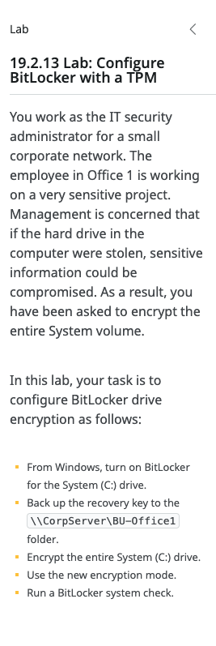

### 02. Initial assessment

Review the task checklist before changing settings; initially, none of the four graded actions was complete.

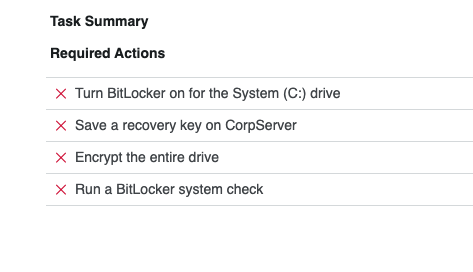

### 03. Open Control Panel

On Office1, open Control Panel. Use the Category view.

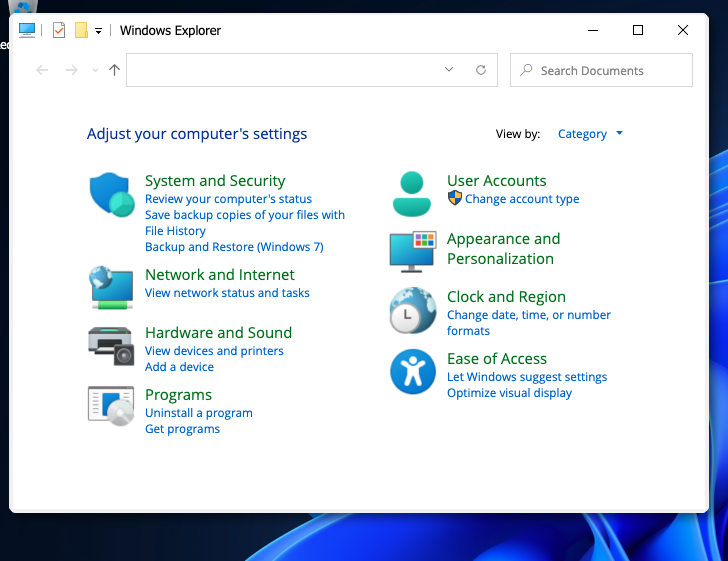

### 04. Navigate to BitLocker

Select **System and Security → BitLocker Drive Encryption**. Under the operating system drive, select **Turn on BitLocker**.

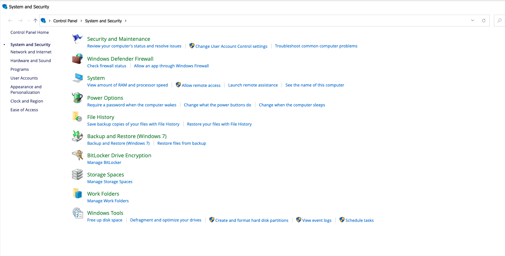

### 05. Choose recovery-key backup

In the BitLocker wizard, select **Save to a file**. A recovery key allows access if the normal TPM-based unlock fails.

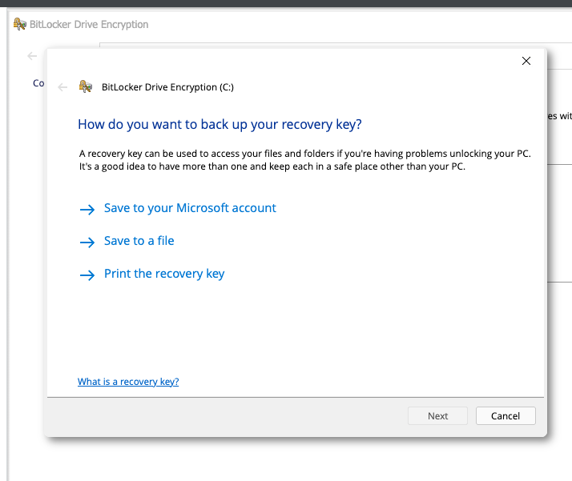

### 06. Save recovery key on the corporate share

Navigate to `\\CorpServer\BU-Office1` in the Save dialog, keep the generated recovery-key filename, and select **Save**. The screenshot shows the selected destination; the final grader confirms the backup task passed. **Never upload the recovery-key text file or its 48-digit secret to a public repository.**

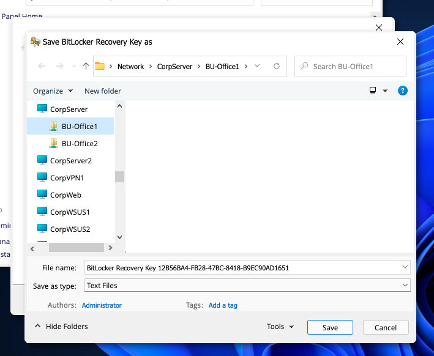

### 07. Review encryption scope

The wizard offers **Encrypt used disk space only** or **Encrypt entire drive**. The lab requires the latter.

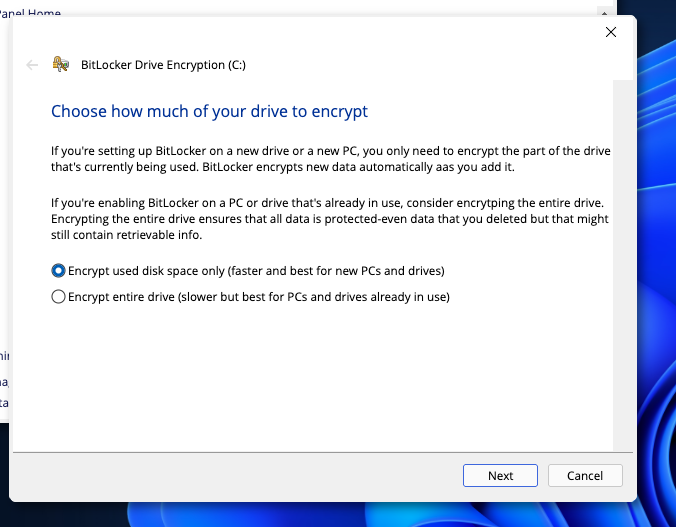

### 08. Select entire-drive encryption

Choose **Encrypt entire drive**, then **Next**. This covers allocated and unallocated space, including potential remnants of deleted data.

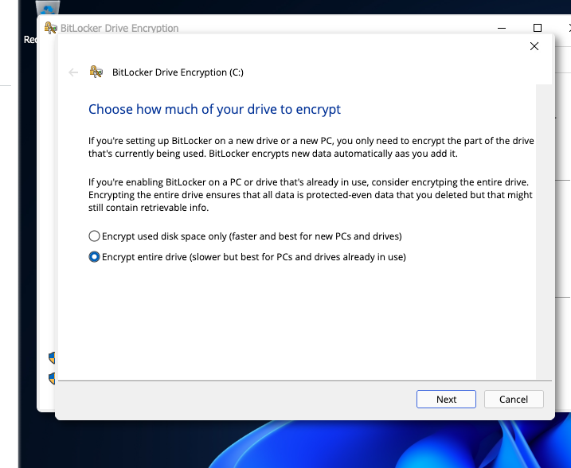

### 09. Choose new encryption mode

Select **New encryption mode** (XTS-AES) for the fixed operating system drive, then **Next**. This is not the removable-drive compatibility option.

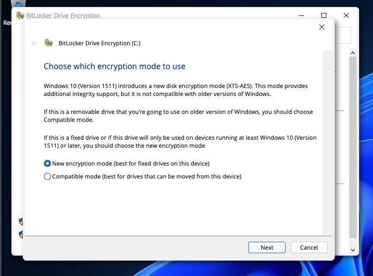

### 10. Enable BitLocker system check

Leave **Run BitLocker system check** selected and click **Continue**. This tests whether the system can unlock the volume during startup before encryption proceeds.

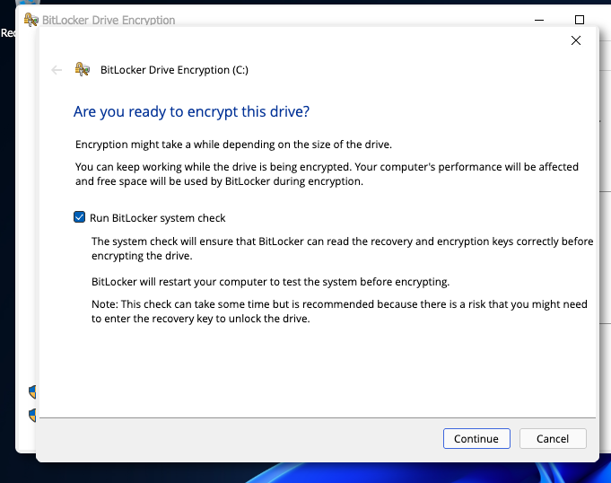

### 11. Restart the workstation

When prompted that the computer must be restarted, click **Restart now**. The restart allows the startup check to run.

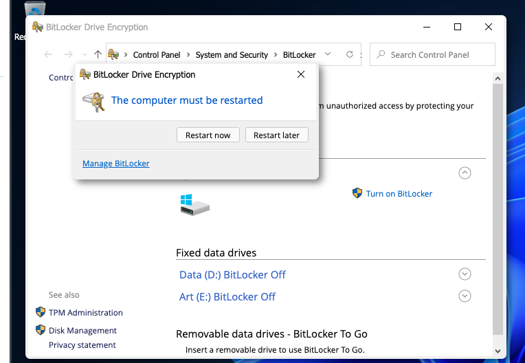

### 12. Monitor encryption

After restarting, observe the encryption progress. The screenshot records **Drive C: 98.4% completed**.

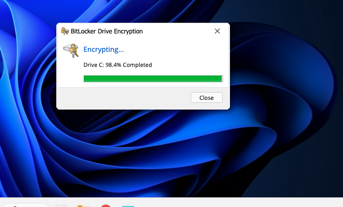

### 13. Confirm completion

The BitLocker dialog states **Encryption of C: is complete**. Close the dialog.

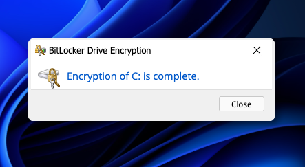

### 14. Verify graded outcome

The final lab report shows **100%**, **3 minutes 54 seconds**, and green checks for enabling BitLocker on C:, saving the recovery key on CorpServer, encrypting the entire drive, and running the system check.

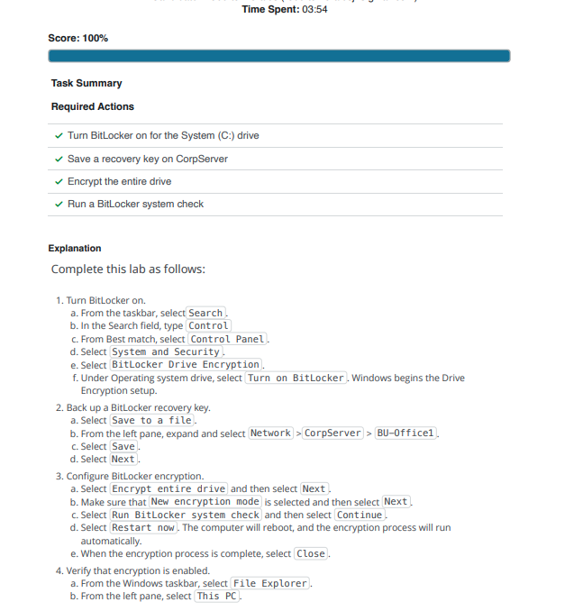

## Outcome and verification

| Check | Evidence | Result |
|---|---|---|
| BitLocker enabled on C: | Final task summary | Passed |
| Recovery key backed up to CorpServer | Final task summary | Passed |
| Entire drive encrypted | Completion dialog and final summary | Passed |
| New encryption mode chosen | Wizard screenshot | Selected |
| System check executed | Restart flow and final task summary | Passed |
| Overall assessment | Final score screenshot | **100%** |

## What I learned

- **BitLocker vs EFS:** BitLocker protects an entire volume at rest; EFS encrypts individual files and folders.
- **TPM:** Helps protect the drive unlock key and ties normal startup unlocking to the system environment.
- **Recovery planning:** A recovery key must be saved to an approved, access-controlled location so a locked system can be recovered.
- **Encryption scope:** Encrypting the entire drive includes unused space, whereas used-space-only encryption is faster on a new system.
- **Startup validation:** A system check helps catch unlock problems before encryption is committed.

## Troubleshooting and operational notes

- If the network location is unavailable, verify connectivity and permissions before saving the recovery key.
- If BitLocker prompts for recovery at boot, use the approved recovery process and verify the system configuration; never publish the recovery password.
- If encryption remains in progress, check BitLocker status and allow the process to finish before declaring completion.
- For real production devices, follow organizational recovery-key escrow, device-management, and change-control policies.

## Security and portfolio note

This is a **training lab**, not evidence of a production deployment. Screenshots show the setup workflow and completion status, not the recovery-key secret. No recovery-key file is included in this repository.

## Skills demonstrated

`Windows 11` · `BitLocker` · `TPM` · `XTS-AES` · `Full-Disk Encryption` · `Recovery Key Management` · `IT Support` · `Endpoint Security` · `Troubleshooting`
